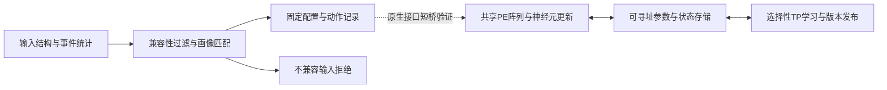

# 类脑智枢：自主重构SNN系统

**BrainHub SNN · 一套共享计算核心，三类固定任务画像，选择性在线适应。**

面向 N-MNIST 事件视觉、SHD 时序语音与 DVS-Gesture 动作识别，本项目将 FC、SRNN、SCNN 映射到同一组计算与存储资源。软件依据少量输入的结构与事件统计选择已定义的画像，硬件通过原生控制接口组织推理和参数更新。

2026 FPGA 赛道自主选题初级组；目标器件 **Virtex-7 XC7VX690T**，工程采用 **SystemVerilog + Python**。原创项目代码采用 **Apache-2.0**。

## 三项工作

1. **共享多拓扑执行。** 12×H40/P4目的端驻留阵列复用计算、神经元更新与存储资源，支持FC、SRNN和SCNN。同容量三套单模式设计之和相比，统一设计综合LUT减少**54.37%**、BRAM36等效用量减少**61.85%**。[原始比较CSV与条件](results/paper_evidence/comparison/fixed_shell_run140_frame_service_20261009/README.md)
2. **输入兼容性约束下的画像选择。** 先检查通道、类别、空间形状等结构条件，再比较任务指纹距离；将选中画像转成配置、排空、派发等动作。未支持的SMNIST/CIFAR10-DVS输入会被拒绝。[画像目录](software/autonomous_reconfiguration/catalog/hardware_profiles.json) · [决策实现](software/autonomous_reconfiguration/snn_reconfig/decision.py)
3. **选择性在线学习与更新可见性。** 基于TP路径组织FC W2、SRNN M2 Wout、SCNN classifier更新，以参数版本边界协调更新与后续推理。[共享学习服务](rtl/learning/unified_tp_shared_output_learning_service_v1.sv) · [版本边界](rtl/learning/unified_tp_train_infer_version_boundary.sv)

## 先看演示

**[打开在线演示 →](https://yyyx05.github.io/brainhub-snn/)**，切换任务并观察画像选择、兼容性拒绝和动作记录。也可下载仓库后，用浏览器打开 **[demo/decision_replay.html](demo/decision_replay.html)**；页面为自包含HTML，没有外部图片或脚本依赖。

该页面回放既有软件决策记录；它不连接FPGA，也不展示实时板级推理。在线版与离线版使用相同的决策记录与交互。

需要运行真实软件入口时，使用Python 3.11，在仓库根目录执行：

```console
python -B scripts/run_autonomous_reconfiguration.py --fingerprint-json software/autonomous_reconfiguration/examples/nmnist_query.json --learning off
```

将输入文件换成同目录的`shd_query.json`或`dvsgesture_query.json`可查看另外两类画像；`smnist_unsupported_query.json`用于查看不兼容任务的拒绝结果。此入口使用标准库及包内JSON，不要求模型权重、完整数据集、Vivado或开发板。输出为dry-run动作记录，画像距离不是分类置信度。

已有决策测试入口：

```console
python -B -m unittest discover -s software/autonomous_reconfiguration/tests -p test_decision.py -v
```

以上是复现命令；仓库整理与公开准备没有重新运行科研实验。

## 当前支持的画像

| 任务 | 画像 / opcode | 固定网络 | 在线更新范围 |
| --- | --- | --- | --- |
| N-MNIST | `fc_nmnist_h160` / `0x01` | FC 2312→160→10 | W2 |
| SHD | `srnn_shd_h450_m2` / `0x10` | 700→450循环骨干 + 450→256→20 M2 | M2 Wout |
| DVS-Gesture | `scnn_dvsgesture_vgg9` / `0x20` | 八卷积VGG-9 + 2048→11 | classifier |



软件前端当前选择三个合格固定画像；任意VGG深度、规模、时间步和精度的运行时搜索属于扩展方向。`--learning auto`使用待标定工程策略，不据此声称已经证明自然分布漂移检测收益。

## 有证据的实现指标

下表对应原生产核心RUN137，工具Vivado 2022.2，器件`xc7vx690tffg1761-3`，15 ns内部核心OOC约束。该结果没有包含板级I/O和DDR约束。

| 指标 | 布线后结果 |
| --- | ---: |
| Slice LUT | 178,070 / 433,200（41.11%） |
| Slice Registers | 80,138 / 866,400（9.25%） |
| BRAM36等效 | 514.5 / 1,470（35.00%） |
| DSP | 1,196 / 3,600（33.22%） |
| WNS / WHS | +0.102 ns / +0.078 ns |
| 完全布通网络 | 321,920 / 321,920 |

[原结果说明与告警边界](results/paper_evidence/physical/run137_scnn_frame_service_impl/README.md) · [资源报告](results/paper_evidence/physical/run137_scnn_frame_service_impl/utilization_post_route.rpt) · [时序报告](results/paper_evidence/physical/run137_scnn_frame_service_impl/timing_summary_post_route.rpt)

原模型软件整数评价为FC 9,537/10,000、SRNN 1,822/2,264、SCNN固定子集250/264；这些是不同任务与样本范围的模型结果，不能直接横向比较，更不等于FPGA完整测试集实测。[软件准确率及协议](results/paper_evidence/supplement_20261004/performance/final_profile_metrics_20261009/software_accuracy.csv)

## 源码导航

| 目的 | 入口 |
| --- | --- |
| 编译生产核心 | [rtl/final_sources.f](rtl/final_sources.f)，105份SV |
| 查看顶层接口 | [unified_h40_final_composition_top_v1.sv](rtl/top/unified_h40_final_composition_top_v1.sv) |
| 查看软件选择与派发 | [snn_reconfig](software/autonomous_reconfiguration/snn_reconfig/) |
| 查看测试平台与定向测试 | [tb](tb/) · [tests](tests/) |
| 查看OOC脚本和约束 | [vivado](vivado/) |
| 使用原生IP | [R2 repository](ip/unified_snn_native/) · [注册脚本](ip/unified_snn_native_ip/register_repository.tcl) |
| 查看隔离优化候选 | [verification/experiments](verification/experiments/) |
| 查阅精选原始证据 | [results/README.md](results/README.md) |
| 阅读复现条件与资产范围 | [docs/reproduction.md](docs/reproduction.md) |
| 复用工程技能 | [skill/README.md](skill/README.md) |
| 了解本轮AI辅助整理 | [docs/llm_work_record.md](docs/llm_work_record.md) |

生产清单与候选目录分别使用；不要递归编译整个仓库中的同名模块。算法ROM位于`rtl/learning/data/`，其读取路径相对工具进程工作目录，因此从仓库根目录启动。

## 复现范围与授权

本公开源码版本**不附带模型权重、完整数据集和派生测试输入**。`models/`、`data/`、`fixtures/`、`imports/`、`memory/`、`tb/data/`是取得合法资产后使用的目录约定，当前仓库中没有这些资产。模型仿真和算法评价需另行准备；标准库JSON指纹入口不依赖它们。[公开版本范围](docs/public_release_scope.md)

当前证据覆盖软件、RTL协议及OOC实现的相应范围；板级接口、数据传输与端到端性能需实际平台验证。源码中的独立优化候选不组成一个已联合验证的版本。历史完整结果、DCP、波形和构建缓存未随仓库提供。

原创贡献使用[Apache License 2.0](license.txt)，归属见[NOTICE](notice.txt)。第三方工具、IP、数据和模型保持各自权利，见[依赖与来源说明](docs/rights_and_dependencies.md)。

公开仓库：[yyyx05/brainhub-snn](https://github.com/yyyx05/brainhub-snn)。
