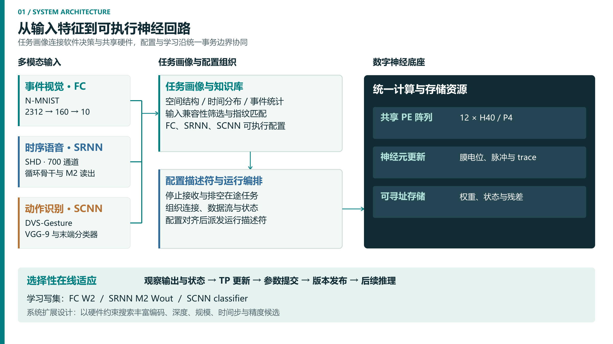

# 类脑智枢：自主重构SNN系统

**BrainHub SNN · 一套共享计算核心，三类任务画像，选择性在线适应。**

面向N-MNIST事件视觉、SHD时序语音与DVS-Gesture动作识别，本项目将FC、SRNN、SCNN映射到统一计算与存储资源。软件提取输入结构与事件统计，匹配任务画像并生成配置动作；共享硬件通过描述符组织数据流，完成推理与选定参数更新。

2026 FPGA赛道自主选题初级组 · **Virtex-7 XC7VX690T** · **SystemVerilog + Python** · **Apache-2.0**

## 核心工作

1. **多拓扑共享执行。** 12×H40/P4目的端驻留阵列复用计算、神经元更新与存储资源。同容量综合比较中，相对三套单模式设计之和，LUT减少**54.37%**、BRAM36等效用量减少**61.85%**。[比较条件与结果](results/paper_evidence/comparison/fixed_shell_run140_frame_service_20261009/README.md)
2. **任务画像驱动配置。** 输入先经过通道、类别和空间形状等结构匹配，再按指纹距离选择画像，生成配置、排空和派发动作；不兼容任务进入拒绝分支。[画像目录](software/autonomous_reconfiguration/catalog/hardware_profiles.json) · [决策实现](software/autonomous_reconfiguration/snn_reconfig/decision.py)
3. **选择性在线学习。** TP路径分别更新FC W2、SRNN M2 Wout和SCNN分类器，利用参数版本边界协调学习结果与后续推理。[共享学习服务](rtl/learning/unified_tp_shared_output_learning_service_v1.sv) · [版本边界](rtl/learning/unified_tp_train_infer_version_boundary.sv)

## 体验任务选择

**[打开在线演示 →](https://yyyx05.github.io/brainhub-snn/)**，切换任务，查看选择依据、配置变化和控制序列。演示采用已有软件决策记录回放；下载后也可用浏览器打开[离线页面](demo/decision_replay.html)。

使用Python 3.11，在仓库根目录执行：

```console
python -B scripts/run_autonomous_reconfiguration.py --fingerprint-json software/autonomous_reconfiguration/examples/nmnist_query.json --learning off
```

入口使用Python标准库与包内JSON，输出画像选择及dry-run动作。将输入换成`shd_query.json`、`dvsgesture_query.json`或`smnist_unsupported_query.json`，可分别查看语音、动作识别和不兼容任务的处理。

```console
python -B -m unittest discover -s software/autonomous_reconfiguration/tests -p test_decision.py -v
```

## 三类网络配置

| 任务 | 画像 / opcode | 网络 | 在线更新范围 |
| --- | --- | --- | --- |
| N-MNIST | `fc_nmnist_h160` / `0x01` | FC 2312→160→10 | W2 |
| SHD | `srnn_shd_h450_m2` / `0x10` | 700→450循环骨干 + 450→256→20 M2 | M2 Wout |
| DVS-Gesture | `scnn_dvsgesture_vgg9` / `0x20` | 八卷积VGG-9 + 2048→11 | classifier |



[查看共享计算核心](docs/assets/shared_core.png)

后续将通过离线约束搜索扩展编码、网络深度、规模、时间步和精度的画像空间，并结合分布变化完善按需学习策略。

## 实现结果

原生产核心RUN137采用Vivado 2022.2、`xc7vx690tffg1761-3`及15 ns OOC约束。

| 指标 | 布线后结果 |
| --- | ---: |
| Slice LUT | 178,070 / 433,200（41.11%） |
| Slice Registers | 80,138 / 866,400（9.25%） |
| BRAM36等效 | 514.5 / 1,470（35.00%） |
| DSP | 1,196 / 3,600（33.22%） |
| WNS / WHS | +0.102 ns / +0.078 ns |
| 完全布通网络 | 321,920 / 321,920 |

[结果说明](results/paper_evidence/physical/run137_scnn_frame_service_impl/README.md) · [资源报告](results/paper_evidence/physical/run137_scnn_frame_service_impl/utilization_post_route.rpt) · [时序报告](results/paper_evidence/physical/run137_scnn_frame_service_impl/timing_summary_post_route.rpt)

软件整数模型评价：FC为9,537/10,000，SRNN为1,822/2,264，SCNN固定子集为250/264。[任务与评价协议](results/paper_evidence/supplement_20261004/performance/final_profile_metrics_20261009/software_accuracy.csv)

## 源码导航

| 阅读目的 | 入口 |
| --- | --- |
| 生产核心与105份SV清单 | [rtl/final_sources.f](rtl/final_sources.f) · [顶层](rtl/top/unified_h40_final_composition_top_v1.sv) |
| 软件画像选择与派发 | [snn_reconfig](software/autonomous_reconfiguration/snn_reconfig/) |
| 测试平台与定向测试 | [tb](tb/) · [tests](tests/) |
| OOC脚本与约束 | [vivado](vivado/) |
| 项目原生IP | [R2 repository](ip/unified_snn_native/) · [注册脚本](ip/unified_snn_native_ip/register_repository.tcl) |
| 独立优化候选 | [verification/experiments](verification/experiments/) |
| 精选实验结果 | [results/README.md](results/README.md) |
| 复现环境与评价范围 | [docs/reproduction.md](docs/reproduction.md) |
| 可复用工程技能 | [skill/README.md](skill/README.md) |
| AI协作记录 | [docs/llm_work_record.md](docs/llm_work_record.md) |

公开仓库提供源码、算法ROM和JSON示例；模型与测试资产的准备方法见[公开版资源说明](docs/public_release_scope.md)。原创贡献采用[Apache License 2.0](license.txt)，项目归属见[NOTICE](notice.txt)，算法来源与依赖见[相关说明](docs/rights_and_dependencies.md)。
